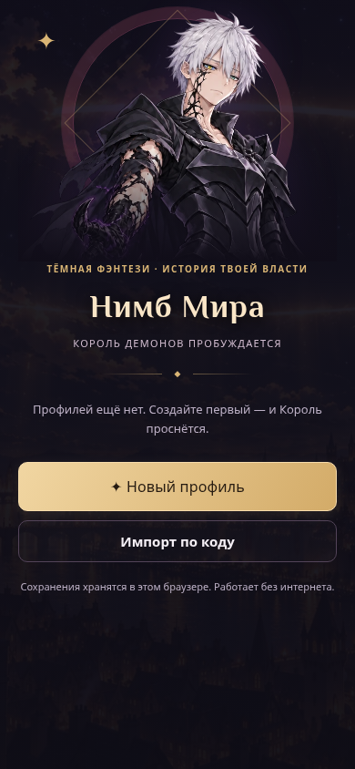
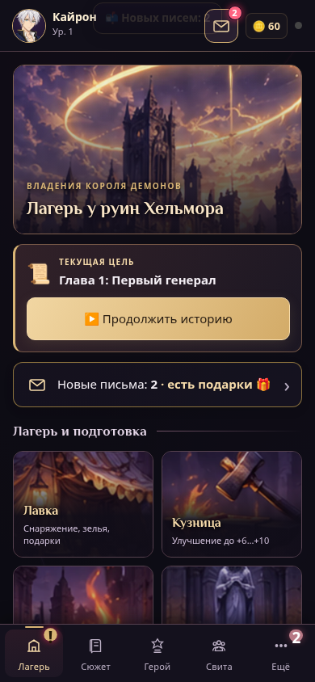
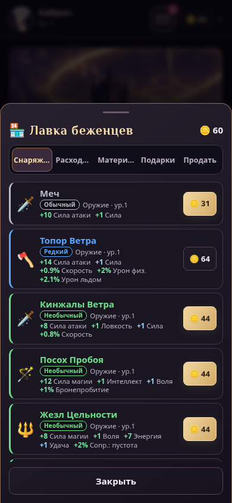

# Интерфейс Короля Демонов

Обсидиановые панели, багряные акценты и матовое золото. На титульном экране — существующий аниме-портрет героя в демонической форме. Баннер лагеря и четыре плитки стали компактнее; цель и действия читаются быстрее. Основной текст и кнопки используют системный шрифт, декоративные заголовки — локальный Philosopher.

Основные кнопки и навигация стали крупнее, добавлена видимая рамка клавиатурного фокуса. Меню «Ещё» показывает активное состояние для дополнительных разделов; скрытые служебные кнопки исключены из клавиатурного обхода. Цвета редкости предметов, HP и MP сохранены. Версия PWA обновлена до 2.14.1, новый стиль и титульный портрет включены в офлайн-кэш.

## Предпросмотр (390 × 844)

## Проверки

- `npm test`: все шесть наборов прошли.
- Браузер Chromium: основные разделы на ширине 320, 360, 390, 480 и 1280 px; прокручиваемые фильтры инвентаря проверялись отдельно от границ контента.
- Переход через «Ещё» и активное состояние дополнительного раздела; офлайн-перезагрузка со стилем из service worker; ошибок JavaScript нет.
- Отдельная проверка на ширине 320 px с уменьшенным движением: две реплики VN переключаются, диалог и кнопки боя помещаются в экран, выбор врага и обычная атака работают.
- Полный `npm run e2e` прошёл создание профиля/героя, пролог, обучение и проверку лагеря, затем перестал продвигаться на проверках настроений VN и был остановлен. Полное прохождение этого сценария не подтверждено.

Визуальный слой находится в `css/crown.css`, подключён после остальных стилей. Механика, формат сохранений и сюжет не изменены.
